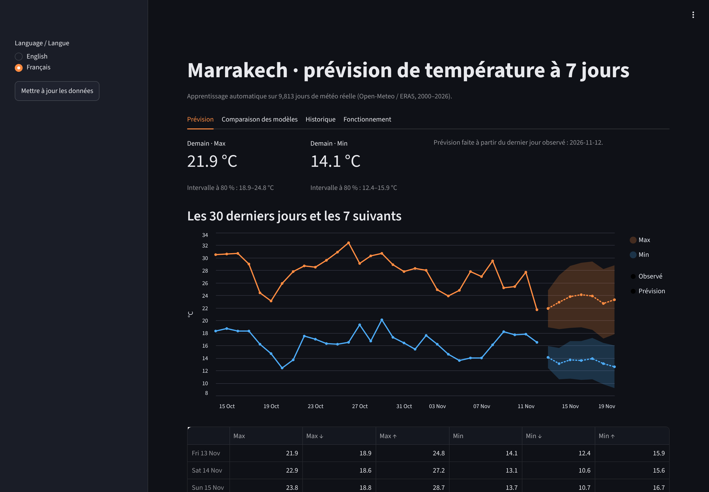
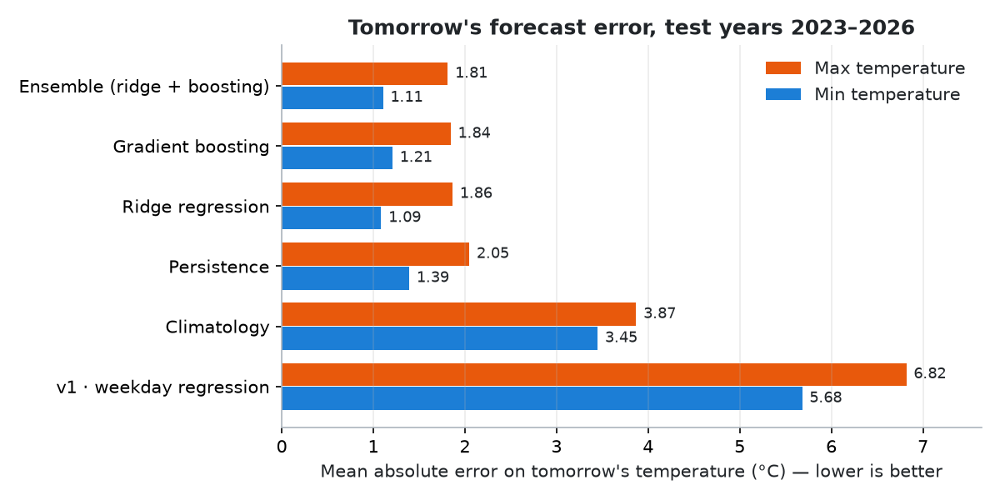
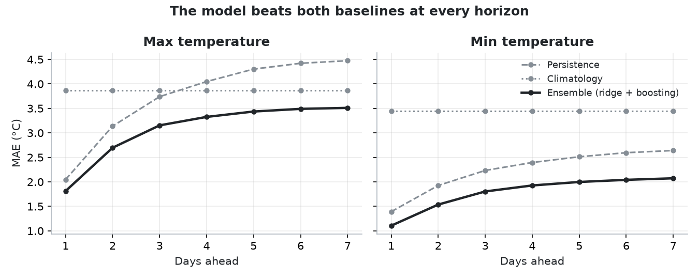
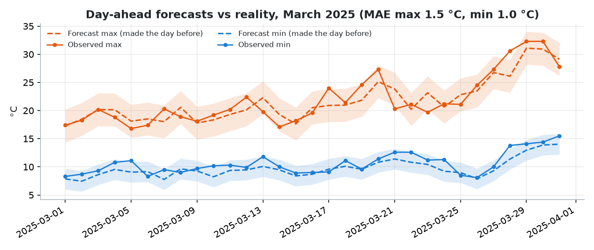
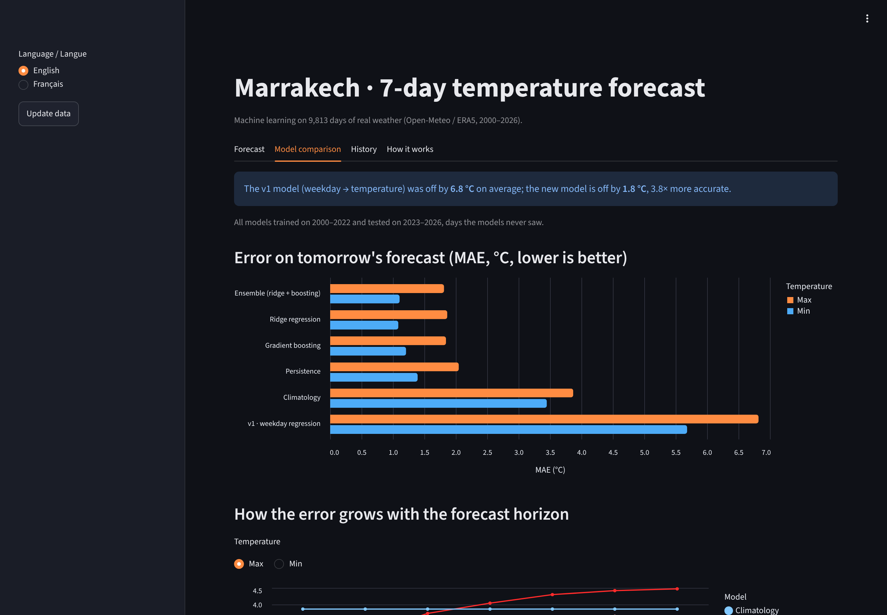
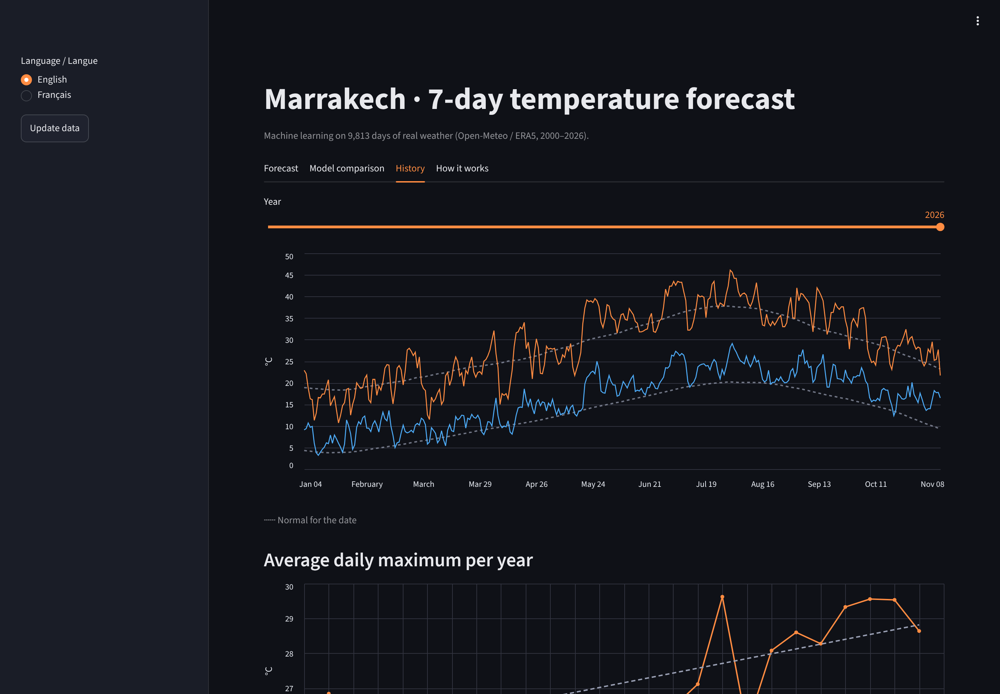
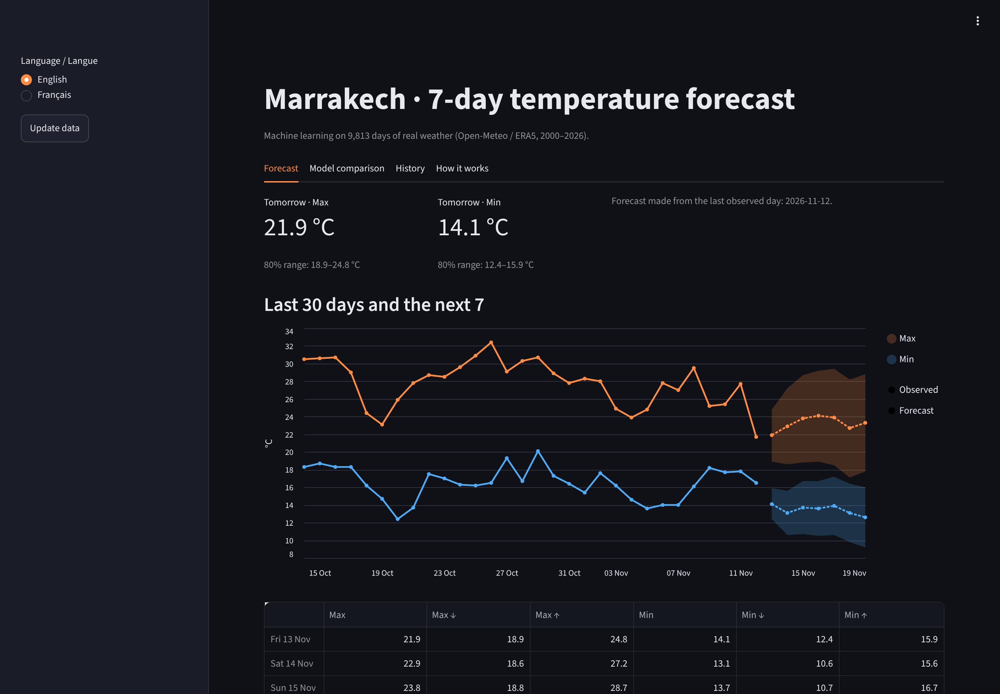
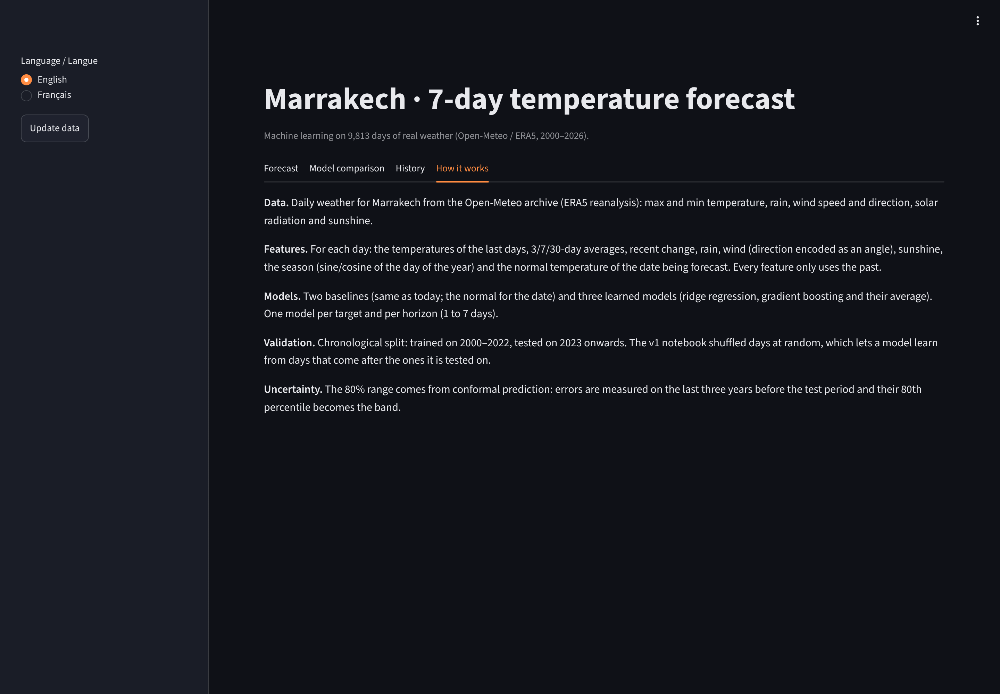
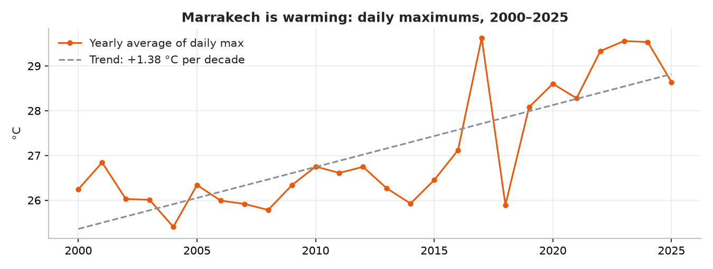

<div align="center">

# 🌡️ Prévision de température à Marrakech

**Prévoir la température des 7 prochains jours à Marrakech par apprentissage automatique, à partir de 26 ans de météo réelle.**

[](https://github.com/Zakariae4AL/Model-Prediction-Temperature/actions/workflows/ci.yml)


[🇬🇧 English](README.md) · 🇫🇷 Français



</div>

## Sommaire

- [Résultats](#résultats)
- [Ce qui a changé depuis la v1](#ce-qui-a-changé-depuis-la-v1)
- [Fonctionnement](#fonctionnement)
- [Tableau de bord](#tableau-de-bord)
- [Démarrage](#démarrage)
- [Structure du projet](#structure-du-projet)
- [Tests et qualité](#tests-et-qualité)
- [Limites](#limites)

## Résultats

Entraînement sur **2000–2022**, test sur **2023 → novembre 2026** : presque quatre ans que les modèles n’ont jamais vus.

| Prévision pour demain | Température max | Température min |
| --- | --- | --- |
| Erreur absolue moyenne | **1,81 °C** | **1,11 °C** |
| À ±2 °C près | 63 % des jours | 85 % des jours |
| R² | 0,91 | 0,94 |
| Meilleur que « comme aujourd’hui » de | 11 % | 21 % |
| Intervalle d’incertitude à 80 % | ±2,9 °C, respecté 79,5 % du temps | ±1,8 °C, respecté 81,9 % du temps |



Le modèle bat les deux références à toutes les échéances, de 1 à 7 jours :



Et voici ce que cela donne sur de vrais jours : prévisions faites la veille, mars 2025.



## Ce qui a changé depuis la v1

La première version prédisait la température **à partir du jour de la semaine** (lundi = 1 … dimanche = 7), avec 20 lignes de données.

| | v1 | v2 |
| --- | --- | --- |
| Données | 20 lignes, sans dates | **9 813 jours** de météo réelle (2000–2026) |
| Entrées | Jour de la semaine | Températures des derniers jours, moyennes glissantes, pluie, vent, ensoleillement, saison, normale du jour |
| Cible | « Jour 8 » | **Max et min** journaliers, **de 1 à 7 jours** à l’avance |
| Validation | Mélange aléatoire (le futur fuit dans l’entraînement) | **Chronologique** : on apprend sur le passé, on teste sur les années suivantes |
| Références | Aucune | Persistance et climatologie |
| Incertitude | Aucune | Intervalle à 80 %, calibré |
| Erreur sur le max de demain | 6,82 °C | **1,81 °C** (3,8× plus précis) |
| Code | Un notebook Colab | Package testé, ligne de commande, tableau de bord, CI |

Pourquoi l’idée du jour de la semaine ne pouvait pas marcher : sur 26 ans, la température maximale moyenne ne varie que de **0,1 °C** entre le jour le plus chaud et le plus frais de la semaine. La météo ne sait pas quel jour on est.

## Fonctionnement


**Données.** Températures maximale et minimale, pluie, vitesse et direction du vent, rayonnement solaire et ensoleillement quotidiens à Marrakech, issus de l’archive [Open-Meteo](https://open-meteo.com/) (réanalyse ERA5).

**Variables.** Pour chaque jour *t* : les températures des derniers jours (décalages 0 à 13), les moyennes et l’écart-type sur 3, 7 et 30 jours, l’évolution sur 3 jours, l’amplitude du jour, la pluie, le vent (direction codée sur un cercle pour que 359° et 1° soient voisins), l’ensoleillement et le rayonnement, la saison (sinus et cosinus du jour de l’année), une tendance lente, et la **normale du jour à prévoir**. Un test vérifie qu’aucune variable du jour *t* n’utilise ce qui vient après *t*.

**Modèles.** Un modèle par cible (max, min) et par échéance (1 à 7 jours) :

- *Persistance* : la température dans *h* jours sera celle d’aujourd’hui.
- *Climatologie* : la température habituelle à cette date, lissée sur 31 jours.
- *Régression ridge* (stable, la meilleure pour les minimales).
- *Gradient boosting* (capte les effets non linéaires, le meilleur pour les maximales).
- **Ensemble** : la moyenne des deux, le meilleur au global. C’est le modèle de production.

**Une évaluation honnête.** Les jours de météo ne sont pas indépendants : les mélanger (comme la v1 avec `train_test_split`) permet au modèle d’apprendre du futur. Ici le découpage est chronologique, et chaque prévision n’utilise que la météo observée jusqu’au jour où elle est faite.

**Incertitude.** L’intervalle à 80 % vient de la **prédiction conforme** : le modèle est réentraîné sans les trois dernières années, ses erreurs sur ces années sont mesurées, et leur 80e centile donne la largeur de l’intervalle. Sur les années de test, la vraie température tombe dans l’intervalle 78 à 82 % du temps, à toutes les échéances.

## Tableau de bord

Une application Streamlit bilingue (anglais / français) : prévision, comparaison des modèles, 26 ans d’historique et une page d’explication.

| Comparaison des modèles | Historique |
| :---: | :---: |
|  |  |
| **Prévision (anglais)** | **Fonctionnement** |
|  |  |

Les données montrent aussi une nette tendance au réchauffement sur la période :



## Démarrage

Prérequis : **Python 3.11 ou plus**.

```bash
git clone https://github.com/Zakariae4AL/Model-Prediction-Temperature.git
cd Model-Prediction-Temperature
python -m venv .venv
source .venv/bin/activate            # Windows (Git Bash) : source .venv/Scripts/activate
pip install -e ".[dev]"
```

```bash
tempforecast forecast                 # les 7 prochains jours (entraînement sur toutes les données, ~1 minute)
tempforecast evaluate                 # comparer tous les modèles sur les années de test
tempforecast fetch                    # télécharger les dernières données Open-Meteo
streamlit run app/dashboard.py        # tableau de bord sur http://localhost:8501
pytest                                # tests
```

Le notebook [`notebooks/exploration.ipynb`](notebooks/exploration.ipynb) présente les données et les choix de modélisation.

Pour mettre à jour les figures après de nouvelles données : `tempforecast evaluate --output reports/scores.csv --coverage reports/coverage.csv`, puis `python scripts/make_figures.py`.

## Structure du projet

```
.
├── src/tempforecast/
│   ├── data.py          chargement, nettoyage et téléchargement des données Open-Meteo
│   ├── features.py      variables et cibles sans fuite du futur
│   ├── models.py        références, ridge, boosting, ensemble, intervalle conforme
│   ├── evaluate.py      découpage chronologique, métriques, couverture de l’intervalle
│   ├── forecast.py      modèle de production et prévision à 7 jours
│   └── cli.py           tempforecast fetch | evaluate | forecast
├── app/dashboard.py     tableau de bord Streamlit (EN / FR)
├── notebooks/           notebook d’exploration
├── data/                météo quotidienne de Marrakech, 2000–2026
├── reports/             résultats de l’évaluation (CSV)
├── scripts/             figures du README et génération du notebook
├── docs/                figures et captures d’écran
└── tests/               tests pytest
```

## Tests et qualité

23 tests tournent sur Python 3.11, 3.12 et 3.13 dans GitHub Actions, avec Ruff pour le style :

- **Données** : lecture des exports Open-Meteo, seuls les petits trous sont comblés, ajout des jours provisoires, HTTPS uniquement.
- **Pas de fuite** : modifier tous les jours après *t* ne doit pas changer les variables du jour *t*.
- **Modèles** : climatologie lisse, persistance, l’ensemble est bien la moyenne de ses membres, l’intervalle s’élargit avec l’échéance, les modèles appris battent les références.
- **Contrôle qualité sur les vraies données** : le build échoue si le modèle ne bat plus « comme aujourd’hui » d’au moins 5 %.
- **Tableau de bord** : l’application Streamlit s’exécute sans navigateur, en anglais et en français, sans erreur.

## Limites

- Un seul lieu (un point de grille ERA5 près de Marrakech) et des valeurs journalières.
- L’archive a environ cinq jours de retard ; `tempforecast fetch` ajoute les derniers jours depuis le service de prévision d’Open-Meteo, marqués comme provisoires.
- Un modèle statistique apprend du passé : il ne voit pas arriver une perturbation venue de l’Atlantique comme le font les modèles météo physiques. Entre 3 et 7 jours, il se rapproche de la normale de saison, ce qui est attendu.
- La tendance au réchauffement est calculée sur 26 ans en un seul point de grille : une observation tirée de ces données, pas une étude climatique.

---

Réalisé par **Zakariae** — [@Zakariae4AL](https://github.com/Zakariae4AL). Données météo © [Open-Meteo](https://open-meteo.com/) (CC BY 4.0), ERA5 par ECMWF / Copernicus. Publié sous [licence MIT](LICENSE).
