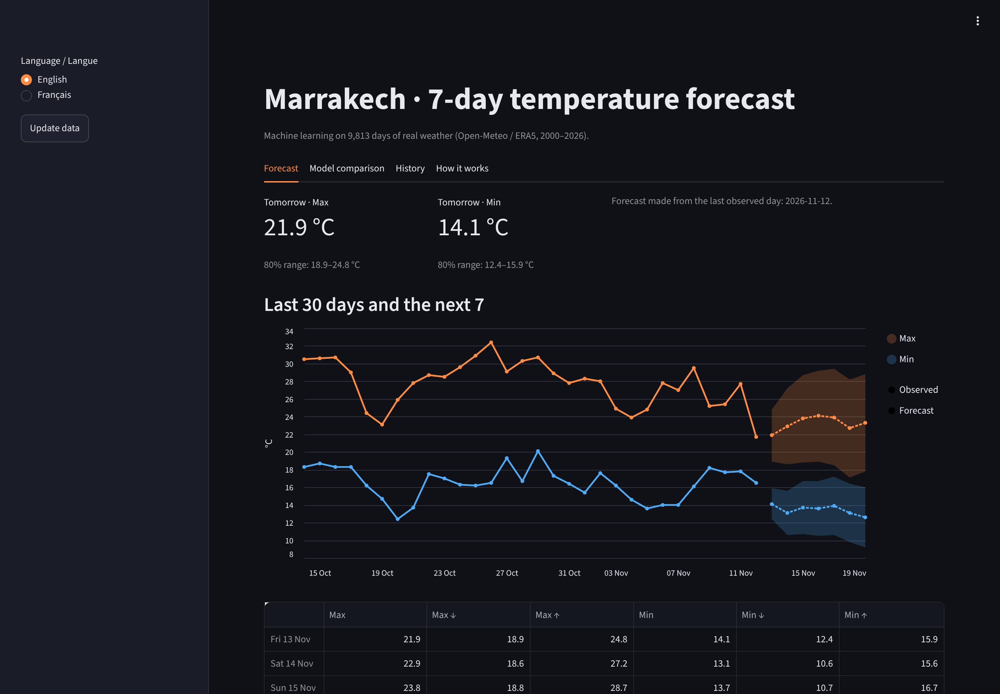
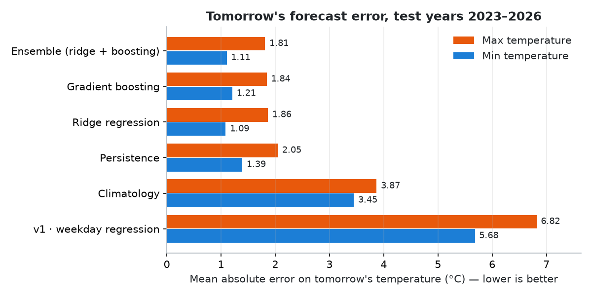
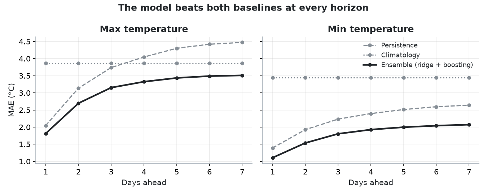
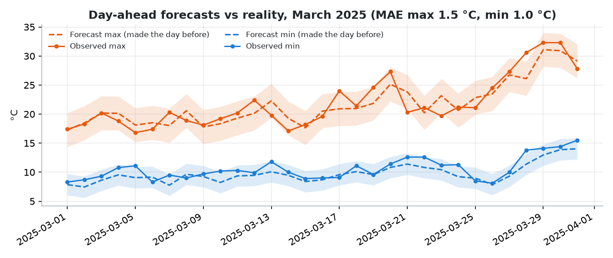
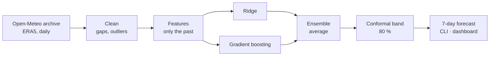
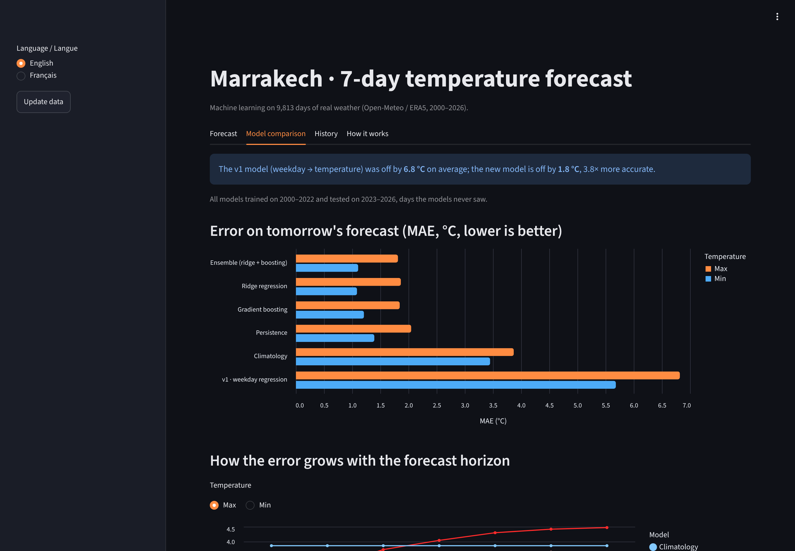
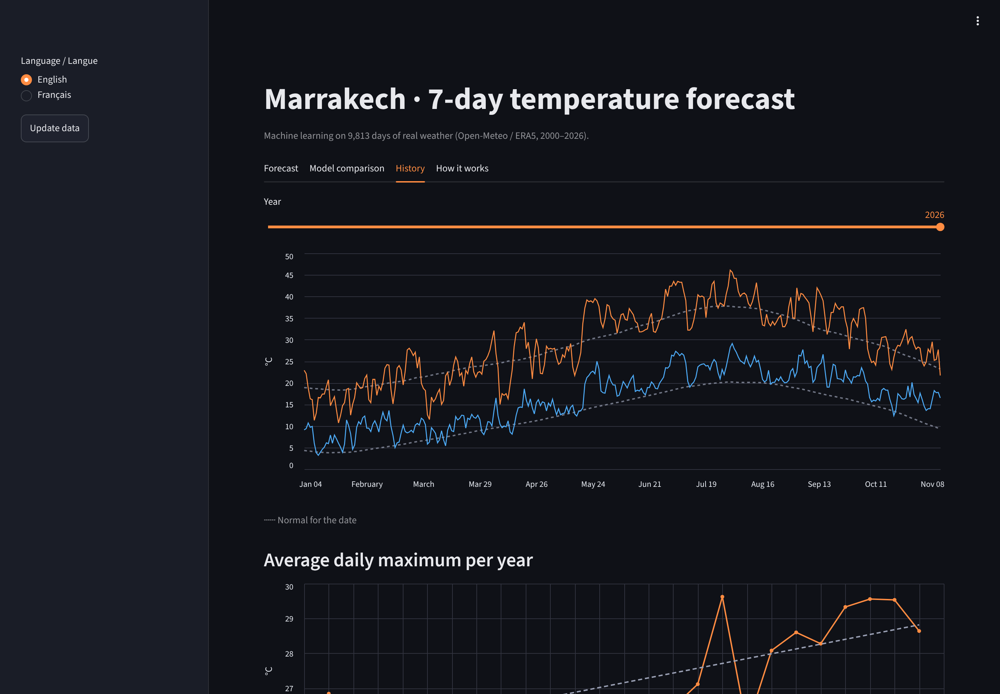
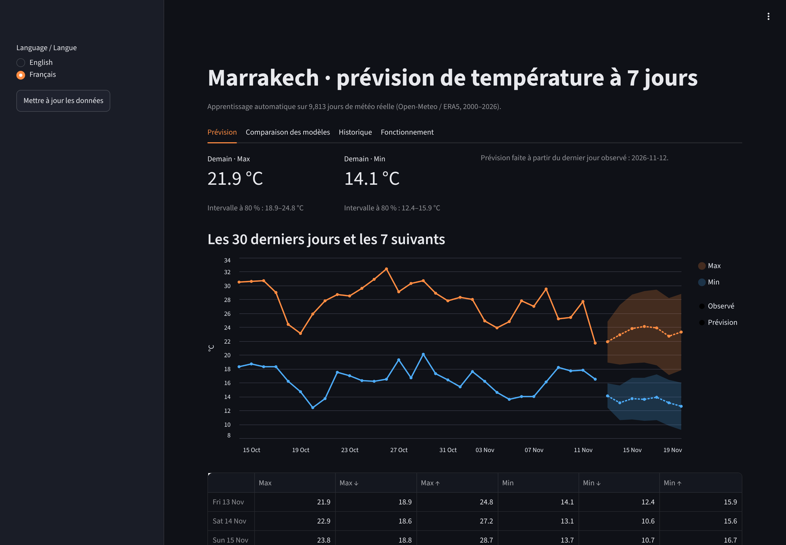
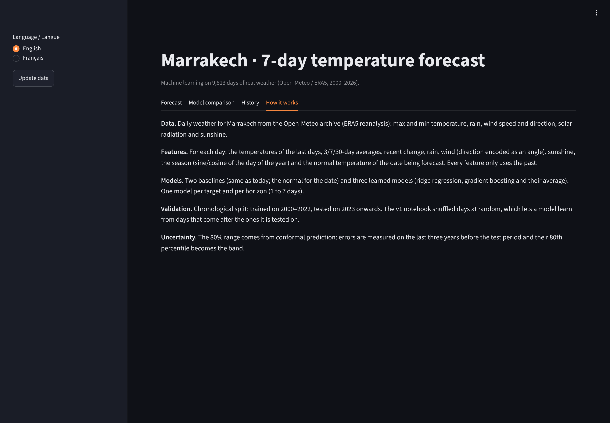
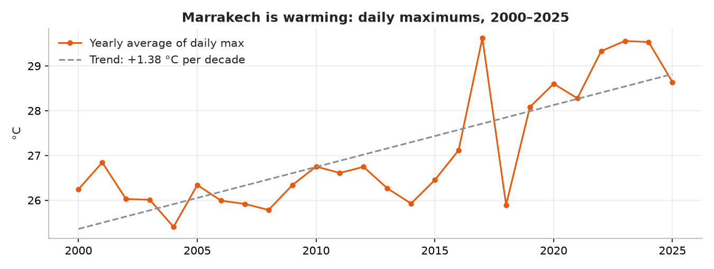

<div align="center">

# 🌡️ Marrakech Temperature Forecast

**Forecasting the next 7 days of temperature in Marrakech with machine learning, trained on 26 years of real weather.**

[](https://github.com/Zakariae4AL/Model-Prediction-Temperature/actions/workflows/ci.yml)


🇬🇧 English · [🇫🇷 Français](README.fr.md)



</div>

## Table of contents

- [Results](#results)
- [What changed since v1](#what-changed-since-v1)
- [How it works](#how-it-works)
- [Dashboard](#dashboard)
- [Getting started](#getting-started)
- [Project structure](#project-structure)
- [Tests and quality](#tests-and-quality)
- [Limits](#limits)

## Results

Trained on **2000–2022**, tested on **2023 → November 2026**: almost four years the models never saw.

| Tomorrow's forecast | Max temperature | Min temperature |
| --- | --- | --- |
| Mean absolute error | **1.81 °C** | **1.11 °C** |
| Within ±2 °C | 63 % of days | 85 % of days |
| R² | 0.91 | 0.94 |
| Better than "same as today" by | 11 % | 21 % |
| 80 % uncertainty band | ±2.9 °C, holds 79.5 % of the time | ±1.8 °C, holds 81.9 % of the time |



The model beats both baselines at every horizon, from 1 to 7 days ahead:



And this is what it looks like on real days: forecasts made the day before, March 2025.



## What changed since v1

The first version predicted the temperature **from the day of the week** (Monday = 1 … Sunday = 7), with 20 rows of data.

| | v1 | v2 |
| --- | --- | --- |
| Data | 20 rows, no dates | **9,813 days** of real weather (2000–2026) |
| Input | Day of the week | Last days' temperatures, rolling averages, rain, wind, sunshine, season, normal for the date |
| Target | "Day 8" | Daily **max and min**, **1 to 7 days ahead** |
| Validation | Random shuffle (future leaks into training) | **Chronological**: train on the past, test on later years |
| Baselines | None | Persistence and climatology |
| Uncertainty | None | 80 % band, calibrated |
| Error on tomorrow's max | 6.82 °C | **1.81 °C** (3.8× more accurate) |
| Code | One Colab notebook | Tested package, CLI, dashboard, CI |

Why the weekday idea could not work: over 26 years, the average maximum differs by only **0.1 °C** between the warmest and the coolest weekday. The weather does not know what day it is.

## How it works



**Data.** Daily maximum and minimum temperature, rain, wind speed and direction, solar radiation and sunshine for Marrakech, from the [Open-Meteo](https://open-meteo.com/) archive (ERA5 reanalysis).

**Features.** For each day *t*: temperatures of the last days (lags 0–13), 3/7/30-day averages and spread, the change over 3 days, the daily range, rain, wind (direction encoded on a circle so 359° and 1° are neighbours), sunshine and radiation, the season (sine and cosine of the day of the year), a slow trend, and the **normal temperature of the date being forecast**. A test proves that no feature of day *t* uses anything after *t*.

**Models.** One model per target (max, min) and per horizon (1–7 days):

- *Persistence*: the temperature in *h* days will be today's.
- *Climatology*: the usual temperature for that date, smoothed over 31 days.
- *Ridge regression* (steady, best for minimum temperatures).
- *Gradient boosting* (catches non-linear effects, best for maximum temperatures).
- **Ensemble**: the average of both, best overall. This is the production model.

**Honest evaluation.** Weather days are not independent, so shuffling them (as v1 did with `train_test_split`) lets a model learn from the future. Here the split is chronological, and every forecast only uses the weather observed up to the day it is made.

**Uncertainty.** The 80 % band comes from **conformal prediction**: the model is retrained without the last three years, its errors on those years are measured, and their 80th percentile becomes the band. On the test years, the real temperature falls inside the band 78–82 % of the time, at every horizon.

## Dashboard

A bilingual (English / French) Streamlit app: forecast, model comparison, 26 years of history and an explanation page.

| Model comparison | History |
| :---: | :---: |
|  |  |
| **In French** | **How it works** |
|  |  |

The data also shows a clear warming trend over the period:



## Getting started

Requirements: **Python 3.11+**.

```bash
git clone https://github.com/Zakariae4AL/Model-Prediction-Temperature.git
cd Model-Prediction-Temperature
python -m venv .venv
source .venv/bin/activate            # Windows (Git Bash): source .venv/Scripts/activate
pip install -e ".[dev]"
```

```bash
tempforecast forecast                 # next 7 days (trains on all data, ~1 minute)
tempforecast evaluate                 # compare every model on the test years
tempforecast fetch                    # download the latest data from Open-Meteo
streamlit run app/dashboard.py        # dashboard on http://localhost:8501
pytest                                # tests
```

```text
Marrakech · forecast from the last observed day: Thursday 12 November 2026

  Fri 13 Nov   max  21.9 °C  [18.9–24.8]   min  14.1 °C  [12.4–15.9]
  Sat 14 Nov   max  22.9 °C  [18.6–27.2]   min  13.1 °C  [10.6–15.6]
  …
Brackets: 80% of real temperatures fall in these ranges.
```

The notebook [`notebooks/exploration.ipynb`](notebooks/exploration.ipynb) walks through the data and the modelling choices.

To refresh the README figures after new data: `tempforecast evaluate --output reports/scores.csv --coverage reports/coverage.csv`, then `python scripts/make_figures.py`.

## Project structure

```
.
├── src/tempforecast/
│   ├── data.py          load, clean and download Open-Meteo data
│   ├── features.py      leak-free features and targets
│   ├── models.py        baselines, ridge, boosting, ensemble, conformal band
│   ├── evaluate.py      chronological split, metrics, band coverage
│   ├── forecast.py      production model and 7-day forecast
│   └── cli.py           tempforecast fetch | evaluate | forecast
├── app/dashboard.py     Streamlit dashboard (EN / FR)
├── notebooks/           exploration notebook
├── data/                Marrakech daily weather, 2000–2026
├── reports/             evaluation results (CSV)
├── scripts/             README figures and notebook builder
├── docs/                figures and screenshots
└── tests/               pytest suite
```

## Tests and quality

23 tests run on Python 3.11, 3.12 and 3.13 in GitHub Actions, with Ruff for linting and formatting:

- **Data**: parsing Open-Meteo exports, filling only short gaps, merging provisional days, HTTPS only.
- **No leakage**: changing every day after *t* must not change the features of day *t*.
- **Models**: smooth climatology, persistence, the ensemble is the average of its members, the band widens with the horizon, learned models beat the baselines.
- **Quality gate on the real data**: the build fails if the model stops beating "same as today" by at least 5 %.
- **Dashboard**: the Streamlit app runs headless in English and French without errors.

## Limits

- One location (a single ERA5 grid point near Marrakech) and daily values only.
- The archive is about five days behind; `tempforecast fetch` adds the last days from Open-Meteo's forecast service, marked as provisional.
- A statistical model learns from the past: it cannot see a weather system coming from the Atlantic the way physical weather models do. For days 3 to 7 it is close to the seasonal normal, which is expected.
- The warming trend is computed from 26 years at one grid point: an observation from this dataset, not a climate study.

---

Made by **Zakariae** — [@Zakariae4AL](https://github.com/Zakariae4AL). Weather data © [Open-Meteo](https://open-meteo.com/) (CC BY 4.0), ERA5 by ECMWF / Copernicus. Released under the [MIT License](LICENSE).
